  

# 📷 Awesome Camera Profile Editing

### 🌈 Curated Suite of SaaS Platforms & Open-Source Projects for Camera Profiling, ICC/DCP Generation & Color Management

  
  
  
  
  

  <b>A comprehensive directory for photographers, imaging engineers, VFX colorists, and color scientists building precise camera characterization pipelines.</b>

---

## 📑 Table of Contents

- [🔍 Sector Overview & Market Dynamics](#-sector-overview--market-dynamics)
- [☁️ SaaS & Commercial Platforms](#️-saas--commercial-platforms)
- [💻 Open-Source GitHub Projects](#-open-source-github-projects)
- [🌟 Star History](#-star-history)
- [🤝 How to Contribute](#-how-to-contribute)
- [💖 Support](#-support)
- [📜 Disclaimer](#-disclaimer)

---

## 🔍 Sector Overview & Market Dynamics

The global color management and digital camera imaging software market is estimated at **$1.8 billion to $2.4 billion**, with steady expansion driven by high-resolution digital imaging, commercial photography, and VFX color-grading pipelines.

The sector is **moderately fragmented**: mega-cap giants like Adobe dominate mainstream RAW decoding and basic camera profile pipelines, while highly specialized hardware-coupled vendors (e.g., Calibrite/X-Rite, Phase One/Capture One, DxO) and independent imaging science developers cater to niche studio workflows, scientific measurement, and film post-production.

---

## ☁️ SaaS & Commercial Platforms

| Product | Description | Pricing | Free Tier Limit | Company Size / Valuation |
| :--- | :--- | :--- | :--- | :--- |
| **[Adobe DNG Profile Editor](https://helpx.adobe.com/camera-raw/digital-negative.html)** | Free utility from Adobe for creating and editing DNG camera profiles, tone curves, and dual-illuminant matrix models. | **$0.00** (Free standalone utility) | **Fully free forever**. No subscription or account required. | **~$230B Valuation** ($21.4B ARR / S&P 500) |
| **[X-Rite ColorChecker Camera Calibration](https://calibrite.com/)** | Industry-standard profiling software bundled with ColorChecker targets for automated ICC/DCP generation. | **$107.00** starting tier (bundled with ColorChecker Passport Photo 2) | **Software license included with target purchase**. No standalone free tier. | **~$10B Parent Corp** (Danaher / Veralto imaging group) |
| **[DxO PhotoLab](https://www.dxo.com/)** | High-end RAW processing suite with optical laboratory modules and custom camera-sensor profile rendering. | **$249.99** one-time purchase (DxO PhotoLab Elite Edition) | **30-day free trial** with full access to all editing modules. No permanent free tier. | **~$45M Annual Revenue** (Established imaging pioneer) |
| **[Capture One](https://www.captureone.com/)** | Pro-grade tethering and RAW developer featuring custom camera color response profiles and 3D color editing. | **$14.99/month** (All in One subscription) or **$299.00** perpetual license | **30-day free trial** with full raw profiling and tethering capabilities. No permanent free tier. | **~$35M Annual Revenue** (Axcel private equity backed) |
| **[Calibrite ColorChecker Studio](https://calibrite.com/)** | End-to-end hardware and software ecosystem for profiling cameras, monitors, scanners, and RGB/CMYK printers. | **€599.00** (~$645.00) complete hardware-software studio kit | **Hardware bundle only**. Profiler software is unlimited with hardware registration; no standalone free tier. | **~$25M Annual Revenue** (Calibrite / X-Rite spin-off) |
| **[3D LUT Creator](https://3dlutcreator.com/)** | Advanced color grading and camera profiling software allowing grid manipulation in A/B and C/L color spaces. | **$99.00** (Grading Edition one-time); Standard $199.00; PRO $249.00 | **Free trial version** available (exporting LUTs is watermarked/restricted). No permanent free tier. | **~$5M Annual Revenue** (Independent imaging boutique) |
| **[Lumariver Profile Designer](https://www.lumariver.com/)** | Dedicated DCP and ICC profile designer engineered for full control over look tables, tone curves, and matrix optimization. | **€100.00** (Repro Edition €200.00) one-time license | **Free trial edition** provided (profile exports locked/watermarked for testing). No permanent free tier. | **~$2M Annual Revenue** (Boutique color science software) |

---

## 💻 Open-Source GitHub Projects

The open-source color profiling ecosystem provides vendor-independent control over raw camera transforms, look tables, and display calibration pipelines.

*Sorted by GitHub stargazers count (descending):*

- **[darktable](https://github.com/darktable-org/darktable)**   
  **Open-source RAW photography workflow and color calibration suite.** **GPL-3.0 licensed**. Includes a built-in camera profiling workflow, color calibration module with chromatic adaptation transforms (CAT16), and support for custom ICC/input camera matrices.

- **[RawTherapee](https://github.com/Beep6581/RawTherapee)**   
  **Advanced raw photo development system.** **GPL-3.0 licensed**. Features comprehensive DCP (DNG Color Profile) and ICC input profile handling, dual-illuminant support, and tight integration with dcamprof for target-based profiling.

- **[colour-science](https://github.com/colour-science/colour)**   
  **Comprehensive Python library for color science algorithms.** **BSD-3-Clause licensed** (NumFOCUS-affiliated). Delivers extensive algorithms for chromatic adaptation, color difference metrics, spectral upsampling, and ACES camera transforms.

- **[OpenColorIO](https://github.com/AcademySoftwareFoundation/OpenColorIO)**   
  **Industry-standard color management framework for visual effects and animation.** **BSD-3-Clause licensed** (Academy Software Foundation). Provides consistent color transforms, 3D LUT generation, and camera profile look implementation across modern production pipelines.

- **[DisplayCAL](https://github.com/eoyilmaz/displaycal-py3)**   
  **The gold-standard graphical frontend for Argyll CMS.** **GPL-3.0 licensed**. Empowers photographers with complete display calibration, custom ICC profile creation, and profiling verification across Windows, macOS, and Linux.

- **[Little-CMS](https://github.com/mm2/Little-CMS)**   
  **Fast, full-featured ICC color management engine library.** **MIT licensed**. Serves as the backbone color transform engine for hundreds of imaging software packages, converting profiles across ICC v2 and v4 standards.

- **[lutgen-rs](https://github.com/ozwaldorf/lutgen-rs)**   
  **Blazing-fast Rust CLI & library for generating interpolated 3D LUTs.** **MIT licensed**. Uses perceptual color spaces (Oklab, CIELAB) to construct custom Hald-CLUTs and lookup tables for photographic toning.

- **[rawtoaces](https://github.com/AcademySoftwareFoundation/rawtoaces)**   
  **ACES-ready RAW camera transform utility.** **BSD-3-Clause licensed** (Academy Software Foundation). Transforms RAW camera sensor digital counts directly into ACES color spaces using spectral sensitivity datasets and custom matrix solvers.

- **[dcamprof](https://github.com/Beep6581/dcamprof)**   
  **Command-line camera profiling tool for creating precise DCP and ICC profiles.** **GPL-3.0 licensed**. Generates camera calibration profiles with custom look tables, forward matrices, and tone curves from ColorChecker target captures.

- **[Argyll CMS](https://github.com/ArgyllCMS/ArgyllCMS)**   
  **The comprehensive, vendor-independent ICC color management suite.** **AGPL-3.0 licensed**. Features 40+ command-line tools covering camera target profiling (`scanin`, `colprof`), display characterization, and profile diagnostic verification.

---

## 🌟 Star History

---

## 🤝 How to Contribute

We welcome contributions from photographers, color scientists, and developers! 

1. 🍴 Fork this repository.
2. 🌿 Create a descriptive feature branch (`git checkout -b add-profiling-tool`).
3. 📝 Add or edit entries in `README.md` following the existing format:
   - For SaaS products: Include pricing, exact free tier / trial terms, and company size.
   - For Open-Source projects: Include GitHub link, social white Stars_Badge, license, and concise description.
4. 🚀 Submit a Pull Request with a clear summary of your changes.

---

## 💖 Support

Thank you for exploring and using **Awesome-Camera-Profile-Editing**! If this curated collection helps your photography or color pipeline:

- ⭐ **Star** this repository on GitHub to help others find it.
- 🍴 **Fork** it to keep your own reference copy.
- 📢 **Share** it with fellow photographers, videographers, and colorists.
- ☕ Consider buying a coffee to support continued maintenance on the [GitHub Sponsors Dashboard](https://github.com/sponsors/ishandutta2007).

---

## 📜 Disclaimer

- This list is a **community-curated directory** for informational purposes; inclusion does not constitute endorsement.
- Hardware-bundled tools (e.g., Calibrite / X-Rite) require authorized physical target or spectrophotometer hardware.
- All brand names, trademarks, and logos belong to their respective copyright holders.

---

  Built with ❤️ for the global photography and color science community.

